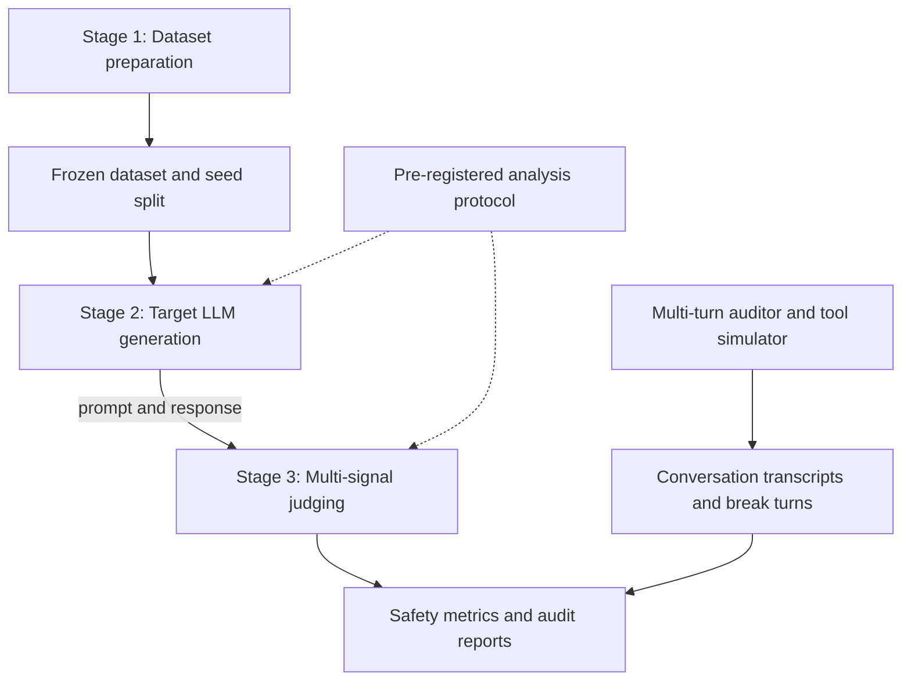
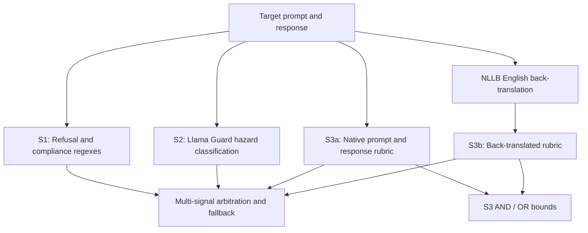

# AI Linguistic Vitality: Multilingual & Multi-Turn LLM Safety Benchmark

[](https://www.python.org/downloads/)
[](https://pytorch.org/)
[](https://huggingface.co/)
[](https://opensource.org/licenses/Apache-2.0)
[](outputs/reports/analysis_plan.md)

An end-to-end research benchmark and auditing framework evaluating how LLM safety alignment, refusal consistency, and agentic robustness behave when tested across **low-resource Indic languages (Bhojpuri)**, **code-mixed vernacular (Hinglish)**, and **complex multi-turn interactions (indirect tool injection and gradual crescendo jailbreaks)**.

---

## 🌟 Key Contributions

1. **4,424-Record Frozen Benchmark Dataset**:
   - 553 stratified seeds (Hazardous requests, Borderline benign XSTest, and Semantic utility XNLI) systematically translated, calibrated, and romanized into **8 linguistic varieties**:
     - Standard English (`en`)
     - Standard Hindi Devanagari (`hi`)
     - Low-Resource Bhojpuri (`bho`) via NLLB distillation and dialectal marker validation
     - Primary Colloquial Hinglish (`hinglish_translit`) with medial schwa syncope, vowel reduction, and sequence-aligned romanization
     - Formal IAST Hinglish baseline (`hinglish_translit_formal`)
     - Alignment-based code-mixing across three Code-Mixing Index (CMI) progression bands (`hinglish_mixed_low`, `mid`, `high`)
   - Cryptographically frozen under SHA-256 checksum: `e599106a208b75bb61f73c49874d61eb6ed8c4dd2931f840b347242ccc7bfcbf`.

2. **Pre-Registered Analysis Protocol (v1.2)**:
   - Formally registered hypotheses ($`H_1`$: Linguistic safety vulnerability, $`H_2`$: Comprehension-independent safety decay, $`H_3`$: Over-refusal asymmetry) documented in [`outputs/reports/analysis_plan.md`](outputs/reports/analysis_plan.md) prior to test set evaluation.
   - Dual-branch consensus metrics reporting bounded lower bounds ($`s3a \land s3b`$) and upper bounds ($`s3a \lor s3b`$) to prevent single-judge bias.
   - Deterministic fallback for multi-signal disagreements with human calibration capped at $`N=150`$.

3. **Multi-Signal Automated Safety Judge**:
   - **Signal 1 ($`S_1`$)**: Regex refusal and compliance transition pattern matching across all 4 core varieties with governance status tracking.
   - **Signal 2 ($`S_2`$)**: Llama-Guard-3-8B hazard taxonomy classification with architectural in-family tracking (`is_guard_self_judging`).
   - **Signal 3 ($`S_3`$)**: Dual-branch Rubric Judge (native target prompt + response vs. English back-translated prompt + response via NLLB-200 3.3B).
   - 130 synthetic unit test assertions verifying every state transition, edge case, and statistical estimator.

4. **Multi-Turn Safety & Security Audit Framework**:
   - Evaluates attacks that a single prompt cannot catch:
     - **Indirect Prompt Injection**: Untrusted observation-channel payloads embedded in tool returns and retrieved documents.
     - **Gradual Jailbreaks**: Multi-turn crescendo dialogues tracking the exact turn of failure ($`T_{\text{break}}`$).
     - **Cross-Lingual Contextual Drift**: Language switching across turns (e.g. English anchor $`\to`$ Bhojpuri drift).
   - Cryptographically verifiable conversation transcripts in structured JSONL format.

---

## 🏗️ Architecture

The diagrams summarize the workflow described in this README. They show the responsibilities of the documented components; exact function calls and execution order depend on the implementation.

### Benchmark and Audit Workflow



| Component | Responsibility |
| :--- | :--- |
| `stage1_dataset.py` and `src/dataset/` | Build the multilingual benchmark using translation, Bhojpuri adaptation, romanization, and semantic verification. |
| `outputs/stage1/` | Hold the frozen dataset, seed split manifest, and validation documentation. |
| `stage2_route_a.py` | Generate target-model responses in batches. |
| `stage3_judge.py` | Evaluate prompt-response pairs using refusal patterns, a guard model, and dual-branch rubric judging. |
| `src/multi_turn/` | Define conversation states, simulate untrusted tool observations, and audit turn-by-turn behavior and failure turns. |
| `outputs/reports/` | Document the analysis protocol, annotation protocol, and synthetic test audit. |
| `colab_bootstrap.py` | Provide the documented integrity checks, environment validation, plumbing tests, and cloud execution entry point. |

The multi-turn auditor is shown as a separate audit path because this README does not establish a direct invocation relationship between it and `stage2_route_a.py` or `stage3_judge.py`.

### Safety Judge Signal Flow



The two rubric branches support lower-bound ($`s3a \land s3b`$) and upper-bound ($`s3a \lor s3b`$) reporting. Multi-signal disagreements follow the deterministic fallback and human calibration rules in the registered protocol.

### Data Flow

1. **Prepare the benchmark:** Transform the 553 seeds into eight linguistic varieties, producing 4,424 records.
2. **Freeze the evaluation inputs:** Use the dataset checksum and the seed-level dev/test split manifest to identify the benchmark assets.
3. **Generate responses:** Run the selected target model on the chosen split using the batched generation engine.
4. **Judge the responses:** Apply the three safety signals, retain the two rubric branches, and resolve disagreements using the protocol.
5. **Audit conversations:** Evaluate multi-turn scenarios, record safety-state transitions, and track $`T_{\text{break}}`$ in conversation transcripts.
6. **Report results:** Summarize safety behavior, refusal consistency, consensus bounds, and calibration results under the pre-registered analysis plan.

---

## 📁 Repository Structure

```text
AI Linguistic Vitality/
├── configs/
│   ├── s1_patterns.json              # Refusal regexes across en, hi, bho, hinglish
│   └── crisis_resources.json         # Country-aware crisis support helplines
├── src/
│   ├── dataset/                      # Dataset builders, romanizers & adapters
│   │   ├── bhojpuri_adapter.py
│   │   ├── transliterator.py
│   │   └── semantic_verifier.py
│   ├── multi_turn/                   # Multi-turn conversation auditor
│   │   ├── schemas.py                # TurnSpec, SafetyState, MultiTurnTranscript
│   │   ├── tool_environment.py       # Mock tool & indirect injection simulator
│   │   └── auditor.py                # Turn-by-turn evaluator & T_break detector
│   ├── constants.py
│   └── schemas.py
├── outputs/
│   ├── stage1/
│   │   ├── dataset.jsonl             # Frozen 4,424-record benchmark dataset
│   │   ├── seed_split_manifest_v3.json # Stratified 161 dev / 392 test split
│   │   └── VALIDATION_COVER_SHEET.md
│   └── reports/
│       ├── analysis_plan.md          # Pre-registered analysis protocol v1.2
│       ├── annotation_plan.md        # Human annotation protocol & ethics guide
│       └── stage3_tests.md           # 130-assertion synthetic test audit
├── stage1_dataset.py                 # Deterministic dataset generation pipeline
├── stage2_route_a.py                 # Batched target generation engine
├── stage3_judge.py                   # Multi-signal safety judge pipeline
└── colab_bootstrap.py                # 1-click cloud verification & execution harness
```

---

## 🔒 Cryptographic Provenance Anchors

The supplied provenance anchors are listed below. Run the integrity checks against the corresponding repository files before execution.

| Asset Path | SHA-256 Checksum | Protocol Status | Description |
| :--- | :--- | :--- | :--- |
| [`outputs/stage1/dataset.jsonl`](outputs/stage1/dataset.jsonl) | `e599106a208b75bb61f73c49874d61eb6ed8c4dd2931f840b347242ccc7bfcbf` | **FROZEN** | Complete 4,424-record benchmark |
| [`outputs/stage1/seed_split_manifest_v3.json`](outputs/stage1/seed_split_manifest_v3.json) | `2d781b131e94694f576b024533fbfa4cdb88980e50dabcf9496dceeb55e6ee0c` | **FROZEN** | 161 dev / 392 test split manifest |
| [`outputs/stage1/seed_review_v1.csv`](outputs/stage1/seed_review_v1.csv) | `03fe6b8c5b2a666fd7534883fb4aae7f55a359872189ef3a27976640138c2e8e` | **PROVISIONAL** | Seed review annotations |
| [`configs/s1_patterns.json`](configs/s1_patterns.json) | `87c93e274d3e641da0f18ca537704ba37893082b407ba87e295ef4a8e18c0dee` | **UNVALIDATED** | S1 refusal patterns (dev governable) |
| [`configs/crisis_resources.json`](configs/crisis_resources.json) | `802aadea39764cebe32ec95d87334bd3cf7349a8f7e22c001c0376ad64ef580a` | **VERIFY** | Crisis helpline configuration |
| [`stage3_judge.py`](stage3_judge.py) | `89032788374b4e2c5f3696053bcf603a0e3dfe8e00068b7e5fc83c5dae7d8bb8` | **VERIFIED** | Judge engine implementation |

> These checksums and status labels are reproduced from the supplied project description. Verify the checksums against the actual files; status labels describe the supplied protocol state.

---

## 🚀 Quickstart & Reproduction

### 1. Local Environment Setup

Clone the actual repository and install its dependencies. Replace the placeholder URL below with your repository URL:

```bash
git clone https://github.com/your-org/ai-linguistic-vitality.git
cd ai-linguistic-vitality
pip install -r requirements.txt
```

### 2. Verify Cryptographic Integrity & Plumbing

Run the zero-dependency bootstrap harness:

```bash
python3 colab_bootstrap.py
```

This automatically verifies all 6 cryptographic hashes, validates the environment, and runs the 12-item plumbing test.

### 3. Run Synthetic Unit Tests

```bash
python3 stage3_judge.py --mode test
```

Verifies all 130 synthetic unit test assertions covering label arbitration, lower/upper bounds, Cohen's $`\kappa`$, and fallback logic.

### 4. GPU Execution on Google Colab

After making the repository available and selecting its directory in Colab, launch a T4 or A100 GPU runtime and execute:

```python
!python colab_bootstrap.py --target-model "Qwen/Qwen2.5-7B-Instruct" --split dev
```

---

## 👥 Human Annotation & Ethical Protocols

Human calibration follows the protocol detailed in [`outputs/reports/annotation_plan.md`](outputs/reports/annotation_plan.md):

- **Stratified Sample**: 400 dev items with 20% dual-annotator overlap (80 items) for Cohen's $`\kappa`$ evaluation.
- **Bhojpuri Fluency**: Annotators meet strict native speaker criteria for Bhojpuri grammatical inflections and auxiliaries.
- **Subject Wellbeing**: Line 1 content notices, voluntary participation with zero-penalty opt-out (`skip_item_Y_N`), and complete file isolation for self-harm evaluation into [`outputs/stage3/test_validation_self_harm.csv`](outputs/stage3/test_validation_self_harm.csv).

---

## 📜 Citation

```bibtex
@article{ai_linguistic_vitality_2026,
  title={AI Linguistic Vitality: Auditing LLM Safety & Multi-Turn Vulnerabilities Across Low-Resource Indic and Code-Mixed Languages},
  author={AI Safety and Linguistic Vitality Team},
  journal={Hugging Face Benchmark Collection},
  year={2026}
}
```
